# a11Lens · Frontend

**a11Lens** es un autocorrector de accesibilidad web: pegas HTML, subes un archivo o escribes una URL; la app detecta los problemas con axe-core en un iframe aislado, los explica en lenguaje simple, la IA propone el código corregido y a11Lens **vuelve a auditar cada corrección antes de mostrarla como solución**. La propia app cumple WCAG 2.2 AA, con el texto principal en AAA.

Proyecto 2 de la materia Programación orientada a la web. Angular 22 (standalone, signals, sin SSR, CSS plano) y axe-core.

## Qué puedes hacer

1. **Auditar** HTML pegado, un `.html` o una URL. Los scripts de la página nunca se ejecutan.
2. Ver el **puntaje** (0 a 100, con «¿Cómo se calcula?») y los **problemas por gravedad**, con su criterio WCAG, selector y fragmento.
3. Ubicarlos en la **lente**: la página con los elementos resaltados, sincronizada con la lista en los dos sentidos.
4. **Explicar y corregir con IA, por fragmentos**: a la IA solo van los elementos con problemas, de a lotes y por gravedad, así que sirve para páginas reales de cualquier tamaño. Cada corrección se aplica en su lugar exacto y solo se muestran como solución las que axe confirma.
5. Comparar **antes y después** y el puntaje del documento corregido.

Mientras recorres la vista previa, la **columna derecha** muestra qué falla en cada elemento a la vista y cómo arreglarlo. Antes de auditar, ofrece dos páginas de ejemplo para probar con un clic. La autoauditoría de a11Lens queda en el pie, como una insignia: «Esta app: 0 problemas WCAG 2.2 AA».
6. **Guardar** en el historial y **exportar** el reporte en Markdown o PDF, o descargar el HTML corregido.
7. Seguir la **evolución del puntaje** de cada página en `/historial`.

El detalle está en [docs/funcionalidades.md](docs/funcionalidades.md).

Backend: <https://github.com/nicolaswagimin/pow-proyecto2-backend>

## Capturas

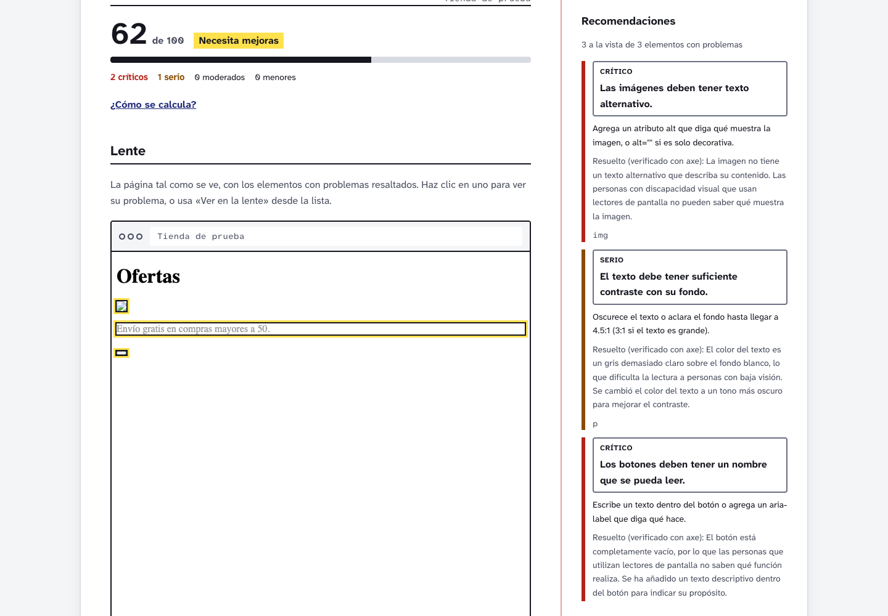

El acceso es una demostración del producto: al enfocar cualquier campo, el margen lo anota con su nombre accesible, rol, estados, contraste y tamaño, leídos del DOM real, y con lo que diría un lector de pantalla. "Auditar esta página" corre axe-core sobre el propio login.

| | Claro | Oscuro |
|---|---|---|
| Acceso, escritorio | 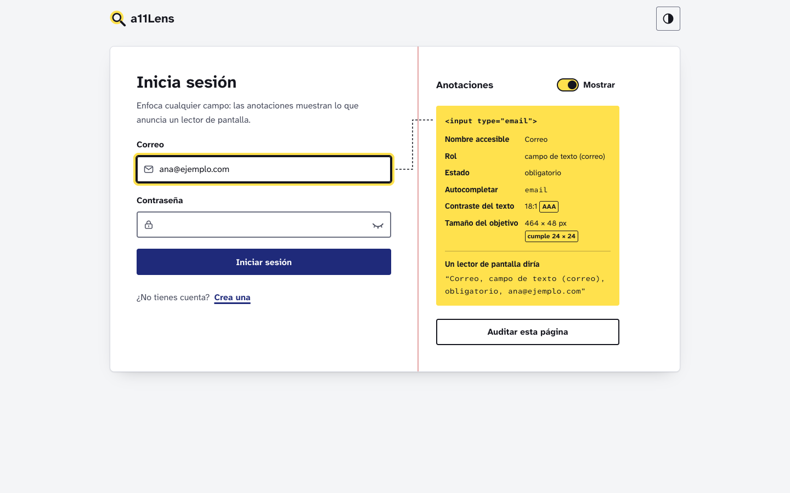 | 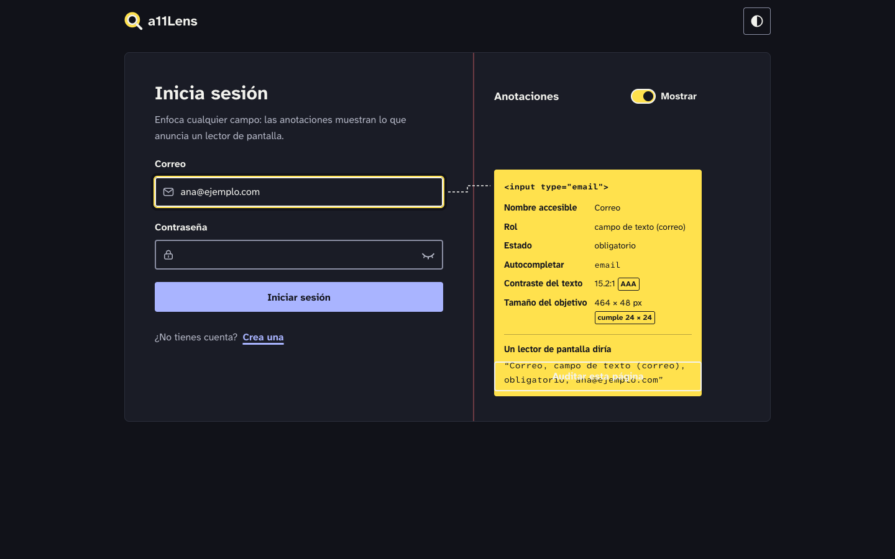 |
| `/app` antes de auditar | 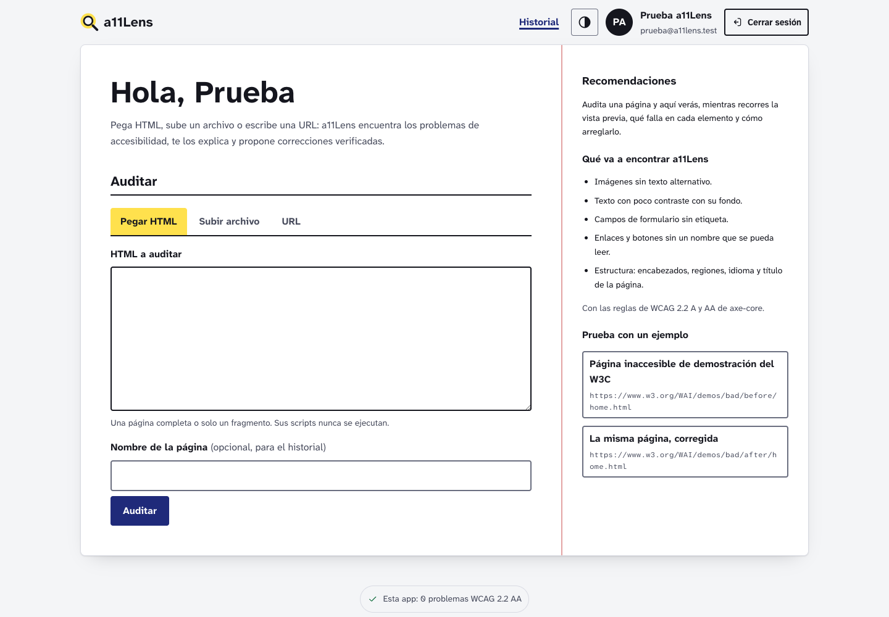 | 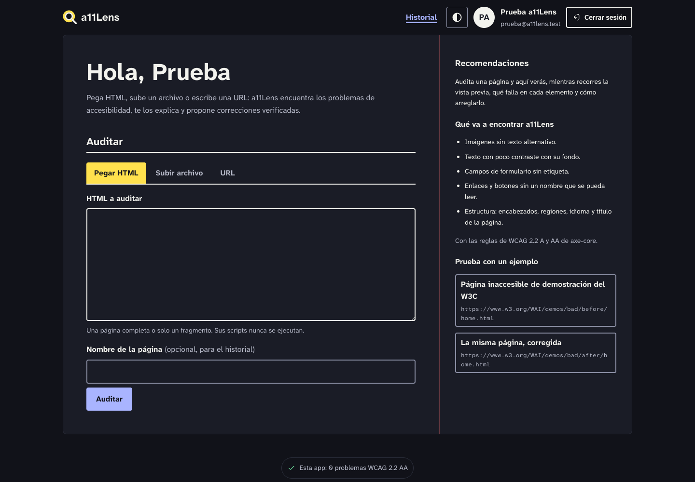 |
| `/app`, escritorio | 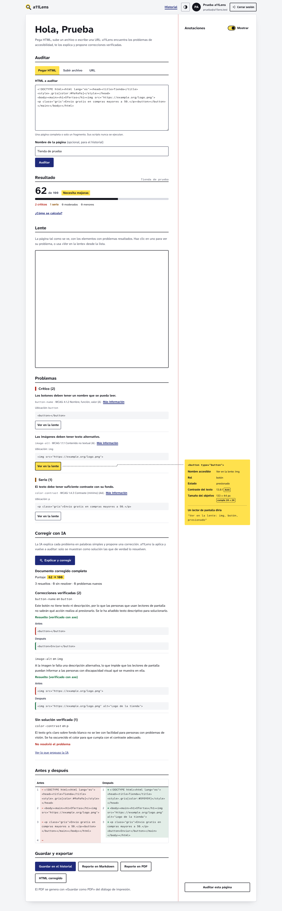 | 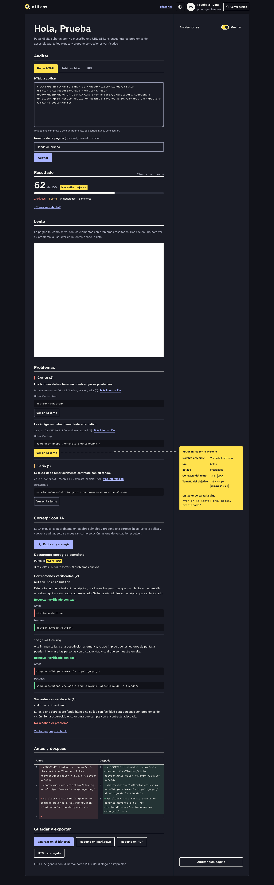 |
| Acceso, móvil | 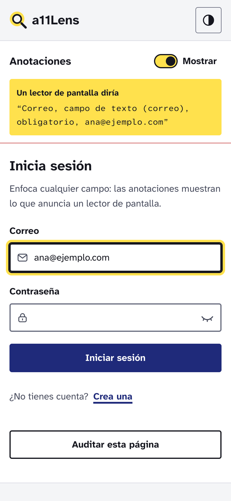 | 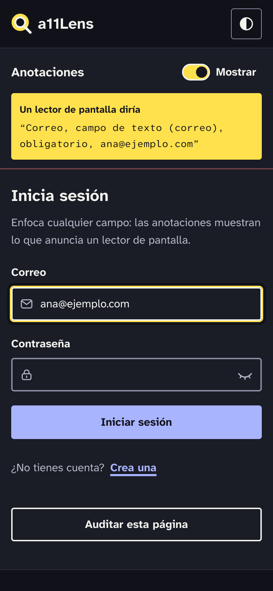 |
| `/historial`, escritorio | 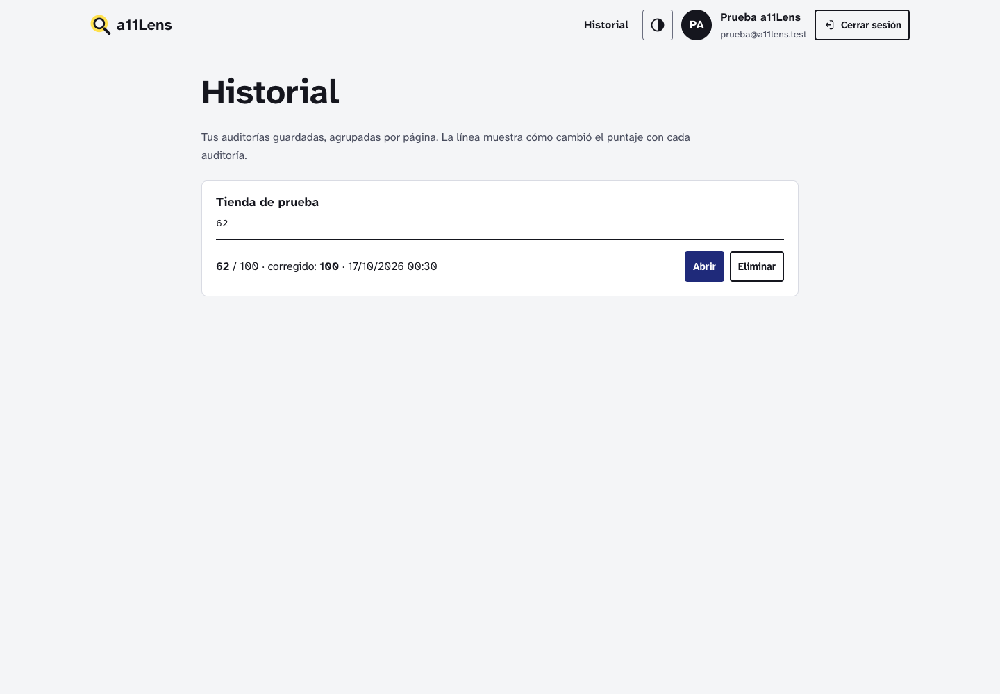 | 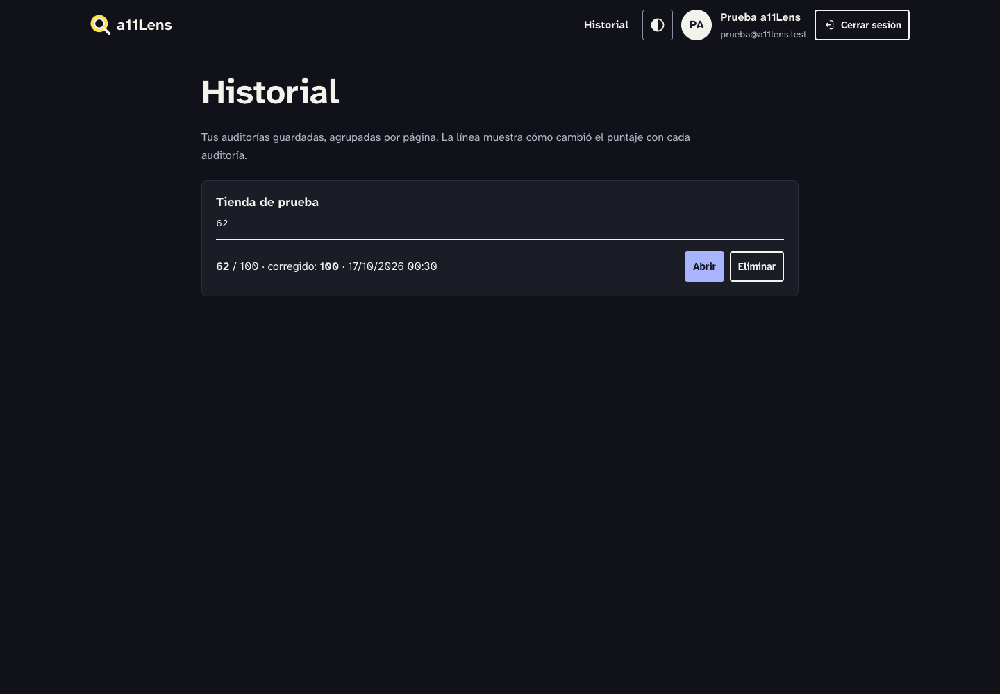 |
| `/app`, móvil | 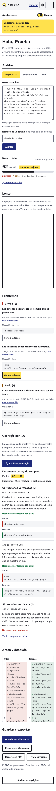 | 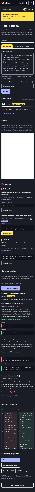 |
| `/historial`, móvil | 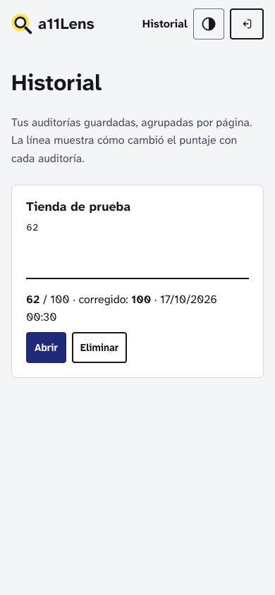 | 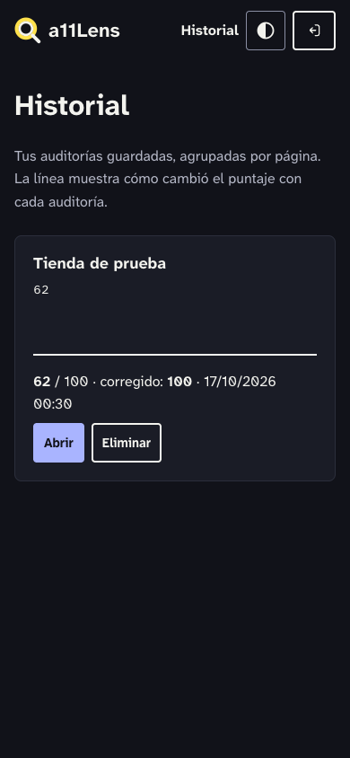 |

## Requisitos

- Node.js 22.22.3+ o 24.15+ (lo exige Angular 22). En Vercel: *Settings → Build and Deployment → Node.js Version* en 22.x o superior.
- El backend corriendo en <http://localhost:3002>.

## Correr en local

```bash
npm install
npm start          # ng serve en http://localhost:4202
```

El puerto está fijo en `angular.json`, así los tres proyectos pueden correr a la vez (desde la carpeta raíz, `./demo.sh` arranca todo).

Sin backend se puede auditar HTML pegado o un archivo (todo corre en el navegador); la URL, la IA y el historial lo necesitan.

Pruebas:

```bash
npm test           # 191 pruebas con Vitest y jsdom
```

Para compilar la versión de producción:

```bash
npm run build      # genera dist/pow-proyecto2-frontend/browser
```

## Rutas

| Ruta | Qué muestra |
|---|---|
| `/` | Redirige a `/app` si hay sesión, o a `/login` si no. |
| `/login` | Inicio de sesión con el margen de anotaciones. |
| `/registro` | Crear cuenta. Comparte componente con `/login`. |
| `/app` | Protegida. La auditoría: entrada, resultado, lente con recomendaciones en vivo, problemas, corrección con IA por fragmentos, antes y después, guardar y exportar. |
| `/historial` | Protegida. Auditorías guardadas agrupadas por página, con la evolución del puntaje. |
| `/design` | Guía de estilo viva: contraste de cada token medido en vivo y componentes. |

## Entornos (URL del backend)

| Archivo | Se usa con | `apiUrl` |
|---|---|---|
| `src/environments/environment.development.ts` | `ng serve` (local) | `http://localhost:3002/api` |
| `src/environments/environment.ts` | `ng build` (producción) | `https://pow-proyecto2-backend.onrender.com/api` |

## Desplegar en Vercel

1. Despliega primero el backend en Render como `pow-proyecto2-backend`.
2. En <https://vercel.com> crea un **New Project** e importa este repositorio.
3. Configura **Framework Preset:** Angular, **Build Command:** `npm run build`, **Output Directory:** `dist/pow-proyecto2-frontend/browser`.
4. Agrega la URL de Vercel a `FRONTEND_URL` del backend en Render (sin `/` final) para que CORS la permita.

`vercel.json` reescribe todas las rutas a `/index.html`, así que recargar `/login` o `/app` no da 404.

## Documentación

| Documento | Contenido |
|---|---|
| [docs/funcionalidades.md](docs/funcionalidades.md) | Qué hace la app, de la entrada al historial |
| [docs/lente.md](docs/lente.md) | Motor aislado: saneado, sandbox, CSP, `<base>` y protocolo de mensajes |
| [docs/reporte.md](docs/reporte.md) | Fórmula del puntaje y formatos de exportación |
| [docs/brief-diseno.md](docs/brief-diseno.md) | Concepto "Margen anotado", demostración del login, direcciones descartadas |
| [docs/design-system.md](docs/design-system.md) | Tokens de color (con contraste), anillo de foco, tipografía, espaciado, radios, sombras y movimiento |
| [docs/componentes.md](docs/componentes.md) | Cada componente con sus inputs, outputs y estados |
| [docs/animaciones.md](docs/animaciones.md) | Qué comunica cada animación y cómo se reduce |
| [docs/accesibilidad.md](docs/accesibilidad.md) | Decisiones de accesibilidad y resultado de axe (24 de 24 vistas sin violaciones) |
| [docs/arquitectura-frontend.md](docs/arquitectura-frontend.md) | Carpetas, rutas, servicios, guards, interceptor, flujo de un login y de una auditoría |
| [docs/decisiones/](docs/decisiones/) | ADR 0001–0005 (diseño) y 0006 axe en iframe con nonce · 0007 verificar antes de mostrar · 0008 PDF con la impresión · 0009 CSP y base para URL |
| [CHANGELOG.md](CHANGELOG.md) | Cambios agrupados |

## Estructura

```
src/
  styles/tokens.css     todos los tokens de diseño
  app/core/             sesión, guards, interceptor, tema, errores, fortaleza
  app/auditor/          motor aislado, puntaje, verificación, diff, exportación y sus componentes
  app/services/         páginas, IA y auditorías
  app/lente/            inspección del DOM, margen de anotaciones (acceso y /design) y auditoría con axe-core de la propia app
  app/ui/               componentes base
  app/layouts/          auth-layout (hoja con formulario y margen), barra-app e insignia-auditoria
  app/pages/            acceso, inicio (/app), historial y guía (/design)
public/auditor/         corredor.js, el script que corre dentro del iframe aislado
```
